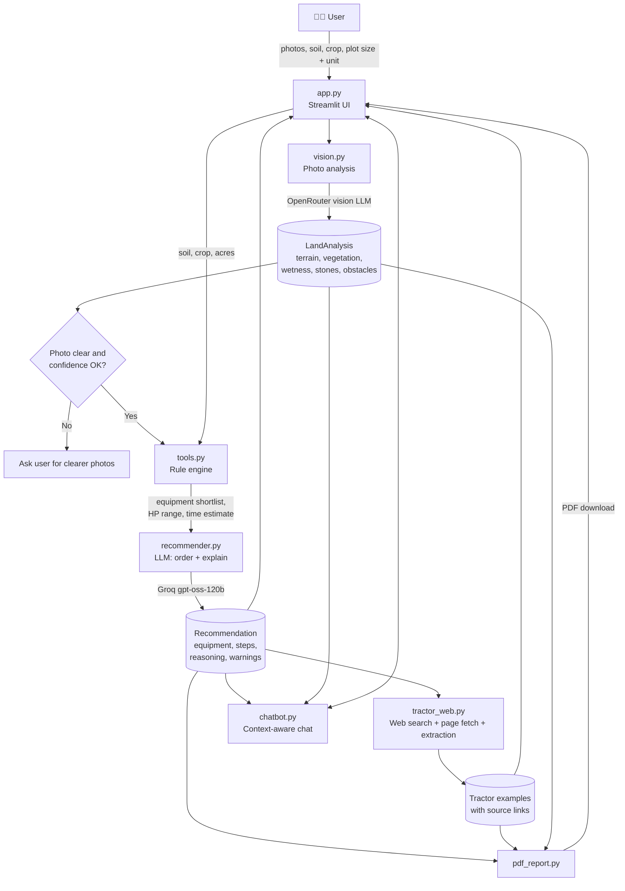

# 🌾 KhetAI: AI-Based Land Preparation Recommendation

Upload photos of a plot, enter soil type, plot size and intended crop, and get a practical land preparation plan: **equipment, tractor power, estimated time, step-by-step workflow and a downloadable PDF report**.

---

## 1. Problem Statement

Build a solution that analyzes an image of a plot of land and recommends suitable machinery and equipment for preparing it for cultivation. The recommendation considers:

- **Visible factors (from image):** terrain, vegetation, land conditions (wetness, stones, obstacles)
- **Additional inputs:** soil type, plot size, intended crop

---

## 2. Features

| Feature | Description |
|---|---|
| Multi-photo analysis | Up to 4 photos, merged conservatively into one land profile |
| Photo quality check | Rejects blurry / non-farmland photos before recommending |
| Rule engine | Soil + crop + land condition → equipment shortlist (transparent, no black box) |
| AI explanation | LLM orders the shortlist, writes steps, reasoning and warnings |
| Tractor power & time | Computed from plot size and implement working speeds |
| Tractor examples | Fetched online (web search); sources shown for verification |
| PDF report | Downloadable report with all details |
| Chat assistant | Ask questions about your field; answers use your report as context |
| No CSV / SQL | All data comes from the image, user input, rules in code and live web search |

---

## 3. Architecture

### 3.1 High-level flow



### 3.2 Text diagram

```
                ┌──────────────────────────────────────────────┐
                │                 app.py (UI)                  │
                │  photos · soil · crop · plot size · chat     │
                └───────┬──────────────────────────┬───────────┘
                        │                          │
              photos    ▼                          ▼  question + report
                ┌───────────────┐          ┌───────────────┐
                │   vision.py   │          │  chatbot.py   │
                │ (OpenRouter)  │          │ (Groq, stream)│
                └───────┬───────┘          └───────────────┘
                        │ LandAnalysis
                        ▼
                ┌───────────────┐   soil, crop, acres
                │   tools.py    │◄────────────────────
                │  rule engine  │
                └───────┬───────┘
                        │ shortlist + HP + time
                        ▼
                ┌───────────────┐
                │ recommender.py│  (Groq gpt-oss-120b)
                │ order+explain │
                └───────┬───────┘
                        │ Recommendation
          ┌─────────────┼───────────────┐
          ▼             ▼               ▼
  ┌──────────────┐ ┌───────────┐ ┌──────────────┐
  │tractor_web.py│ │pdf_report │ │  UI report   │
  │ DDG + fetch  │ │  .py      │ │  (tabs)      │
  └──────────────┘ └───────────┘ └──────────────┘
```

### 3.3 Design decision: rules decide, AI explains

The numbers and equipment choices must be **predictable and explainable**, so they are **not** left to the LLM:

| Output | Decided by |
|---|---|
| Equipment shortlist | **Rule engine** (`tools.py`): soil, crop, terrain, vegetation, wetness, stones |
| Tractor HP range | **Rule engine**: based on plot size |
| Estimated time | **Rule engine**: `Σ (acres ÷ implement speed) × 1.15` (15% turning/setup allowance) |
| Working order, steps, reasoning, warnings | **LLM** (restricted to the shortlist; cannot add equipment) |
| Confidence | Lower of photo confidence and LLM confidence |

If the LLM fails, the app falls back to the rule-engine output, so it still returns a usable plan.

### 3.4 Module responsibilities

| File | Responsibility |
|---|---|
| `app.py` | Streamlit UI: upload, form, report tabs, PDF download, chat |
| `vision.py` | Photo → `LandAnalysis` (OpenRouter vision model); merges multiple photos |
| `tools.py` | Unit conversion, **rule engine** (`rule_shortlist`), search/wiki/save helpers |
| `recommender.py` | Shortlist + analysis → ordered equipment, steps, reasoning, warnings |
| `tractor_web.py` | Online search + page text fetch + LLM extraction of tractor examples |
| `pdf_report.py` | Builds the PDF report (ReportLab) |
| `chatbot.py` | Streaming Q&A grounded in the generated report |
| `main.py` | Terminal version for quick testing |

---

## 4. Rule Logic (summary)

| Condition | Equipment decision |
|---|---|
| Shrubs / trees / dense vegetation | Mulcher + Disc plough (remove stumps manually first) |
| Black or clay soil (otherwise) | Mould board plough |
| Other soils | Cultivator |
| Stones visible | Disc harrow (rotavator avoided to protect blades) |
| Paddy + moist/waterlogged field | Puddler |
| Otherwise | Rotavator |
| Uneven / gentle slope | Land leveller / scraper |
| Steep slope | Warning: contour bunding, avoid heavy implements |
| Always (final pass) | Planker |
| Wheat / soybean / mustard | Seed drill |
| Maize / cotton | Planter |
| Sugarcane | Ridger |
| Waterlogged (non-paddy) | Warning: drain first |

**Tractor HP by plot size:** ≤2 ac → 25-35 HP · ≤5 ac → 35-45 HP · ≤10 ac → 45-55 HP · >10 ac → 55-75 HP

> Implement speeds and HP slabs in `tools.py` are **approximate defaults**. Verify with a local agronomist or agricultural university data before real-world use.

---

## 5. Tech Stack

- **UI:** Streamlit
- **Vision LLM:** OpenRouter (`openrouter/free` router by default, or a fixed model via `OPENROUTER_MODEL`)
- **Text LLM:** Groq (`openai/gpt-oss-120b`) via LangChain
- **Web data:** DuckDuckGo search (`ddgs`) + `requests` + `BeautifulSoup`
- **PDF:** ReportLab
- **Validation / schemas:** Pydantic
- **Images:** Pillow

---

## 6. Setup

### 6.1 Install

```bash
python -m venv .venv
.venv\Scripts\activate          # Windows
pip install streamlit pillow reportlab ddgs requests beautifulsoup4 \
            python-dotenv pydantic langchain langchain-groq \
            langchain-openai langchain-community
```

### 6.2 Environment (`.env`)

```
GROQ_API_KEY=your_groq_key
OPENROUTER_API_KEY=sk-or-your_openrouter_key
# Optional: fix one vision model for consistent results
# OPENROUTER_MODEL=google/gemma-3-27b-it:free
```

### 6.3 Run

```bash
streamlit run app.py     # web UI
python main.py           # terminal test
```

---

## 7. Project Structure

```
AI-Based_Land_Preparation/
├── app.py
├── main.py
├── tools.py
├── vision.py
├── recommender.py
├── tractor_web.py
├── chatbot.py
├── pdf_report.py
├── .env
└── README.md
```

---

## 8. Example Run

**Input:** 1 photo · Black soil · Paddy · 20 bigha (≈ 12.5 acres)

**Photo analysis:** flat terrain · mixed vegetation (medium) · moist · stones visible · boulders

**Output:**

| Item | Result |
|---|---|
| Equipment (in order) | Mould board plough → Disc harrow → Puddler → Planker |
| Tractor power | 55-75 HP |
| Estimated time | 43.7 hr |
| Warning | Stones visible: rotavator avoided |

---

## 9. Test Cases

Fill this table after running your own photos (recommended: at least 5 varied cases).

| # | Photo condition | Soil | Crop | Plot | Equipment output | HP | Time |
|---|---|---|---|---|---|---|---|
| 1 | Mixed vegetation, stones, moist | Black | Paddy | 12.5 ac | MB plough, Disc harrow, Puddler, Planker | 55-75 | 43.7 hr |
| 2 | Bare, flat, dry | | | | | | |
| 3 | Dense weeds / shrubs | | | | | | |
| 4 | Waterlogged | | | | | | |
| 5 | Uneven / sloped | | | | | | |

---

## 10. Limitations

- **Image-only analysis is limited.** Soil depth, compaction, salinity and real moisture cannot be judged from a photo. The user's soil input is used for those.
- **Rule values are approximate.** Implement speeds and HP slabs are defaults and should be calibrated with local data.
- **Vision output can vary** when using the free random router. Use a fixed model for consistent results.
- **Tractor examples depend on live web search.** They may be missing or outdated; always verify via the source link and a local dealer.
- **Bigha size varies by region.** The app uses an approximate 0.625 acre.
- **Free APIs are rate-limited.** Retry after a short wait if a request fails.
- This is a **decision-support tool**. Confirm with a local agronomist before hiring machinery.

---

## 11. Future Improvements

- Fine-grained soil rules (e.g. sandy-soil depth limits, moisture-based timing)
- Weather / season awareness for tillage timing
- Cost estimate for machinery rental
- Hindi / regional language UI
- Satellite or drone image input for large plots
