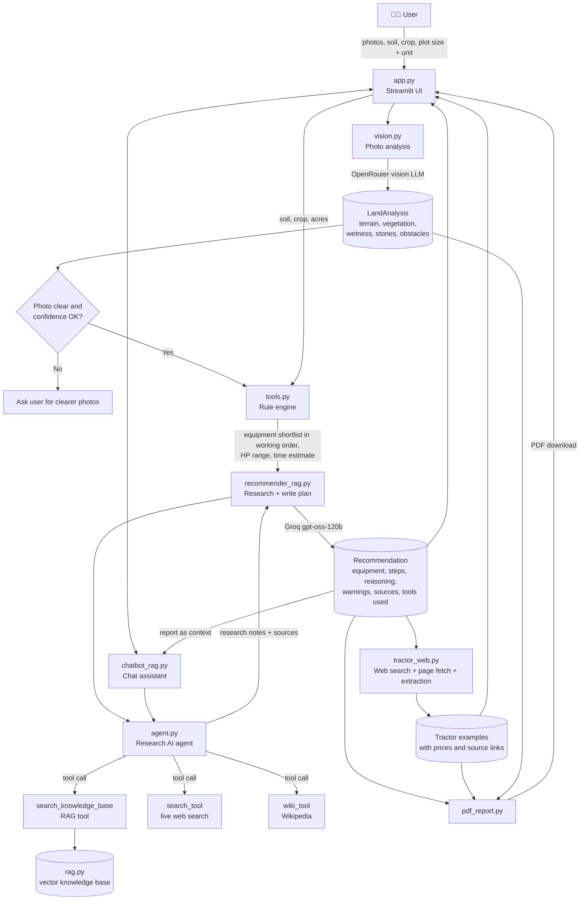

# 🌾 KhetAI: AI-Based Land Preparation Recommendation

Upload photos of a plot, enter soil type, plot size and intended crop, and get a practical land preparation plan: **equipment, tractor power, estimated time, step-by-step workflow and a downloadable PDF report**. The plan is backed by an **AI agent** that researches the web through a **RAG pipeline** and cites its sources.

---

## 1. Problem Statement

Build a solution that analyzes an image of a plot of land and recommends suitable machinery and equipment for preparing it for cultivation. The recommendation considers:

- **Visible factors (from image):** terrain, vegetation, land conditions (wetness, stones, obstacles)
- **Additional inputs:** soil type, plot size, intended crop

---

## 2. Features

| Feature | Description |
|---|---|
| Multi-photo analysis | Up to 4 photos, merged conservatively into one land profile |
| Photo quality check | Rejects blurry / non-farmland photos before recommending |
| Rule engine | Soil + crop + land condition → equipment shortlist and working order (transparent, no black box) |
| **AI research agent** | Tool-calling LLM agent that decides when to use the knowledge base, live web search or Wikipedia |
| **RAG pipeline** | Web pages → chunks → embeddings → vector search → grounded passages with source URLs |
| AI explanation | LLM writes steps, reasoning and warnings, grounded in the retrieved notes |
| Tractor power & time | Computed from plot size and implement working speeds |
| Tractor examples | Fetched online (search + page fetch + extraction); prices and source links shown |
| PDF report | Downloadable report including agent tools used and RAG sources |
| Chat assistant | Same agent + RAG; answers use your report as context and cite sources |
| No CSV / SQL | All data comes from the image, user input, rules in code and live web retrieval |

---

## 3. Architecture

### 3.1 High-level flow



### 3.2 Text diagram

```
                ┌──────────────────────────────────────────────┐
                │                 app.py (UI)                  │
                │  photos · soil · crop · plot size · chat     │
                └───────┬──────────────────────────┬───────────┘
                        │                          │
              photos    ▼                          ▼  question + report
                ┌───────────────┐          ┌─────────────────┐
                │   vision.py   │          │ chatbot_rag.py  │
                │ (OpenRouter)  │          └────────┬────────┘
                └───────┬───────┘                   │
                        │ LandAnalysis              │
                        ▼                           │
                ┌───────────────┐   soil, crop, acres
                │   tools.py    │◄────────────────  │
                │  rule engine  │                   │
                └───────┬───────┘                   │
                        │ shortlist (in order)      │
                        ▼                           ▼
                ┌────────────────────┐      ┌───────────────┐
                │ recommender_rag.py │─────►│   agent.py    │
                │  plan writer (LLM) │◄─────│  tool-calling │
                └───────┬────────────┘ notes└───┬───┬───┬───┘
                        │                       │   │   │
                        │            ┌──────────┘   │   └───────────┐
                        │            ▼              ▼               ▼
                        │     ┌────────────┐  ┌───────────┐  ┌───────────┐
                        │     │  rag.py    │  │search_tool│  │ wiki_tool │
                        │     │ RAG (KB)   │  │ (web)     │  │           │
                        │     └────────────┘  └───────────┘  └───────────┘
                        │ Recommendation
          ┌─────────────┼───────────────┐
          ▼             ▼               ▼
  ┌──────────────┐ ┌───────────┐ ┌──────────────┐
  │tractor_web.py│ │pdf_report │ │  UI report   │
  │ DDG + fetch  │ │  .py      │ │  (tabs)      │
  └──────────────┘ └───────────┘ └──────────────┘
```

### 3.3 RAG pipeline (`rag.py`)

```
 crop + soil
     │
     ▼
 4 search queries ──► DuckDuckGo (region: India)
     │
     ▼
 filter blocked / spam sites ──► trusted agri & research sites first
     │
     ▼
 fetch top pages (parallel) ──► clean HTML text
     │
     ▼
 chunk (900 chars, 150 overlap)
     │
     ▼
 embed (BAAI/bge-small-en-v1.5 via fastembed) ──► in-memory vector store (cached per crop + soil)
     │
     ▼
 query ──► embed ──► cosine similarity ──► top-k chunks (max 2 per source)
     │
     ▼
 passages + SOURCE URLs ──► returned to the agent as tool output
```

If `fastembed` is unavailable, retrieval automatically falls back to **keyword matching**, so the app keeps working.

### 3.4 AI agent (`agent.py`)

The agent is a **tool-calling LLM** (LangChain `create_agent`, Groq `gpt-oss-120b`). It is used in two places:

| Where | Goal | Tools available |
|---|---|---|
| **Research step** (before the plan is written) | Collect land preparation practices and implement tips for the exact crop, soil and field condition | `search_knowledge_base` (RAG), `search_tool`, `wiki_tool` |
| **Chat assistant** | Answer farmer questions from the report, or from retrieved knowledge for general questions | same three tools |

The agent decides **which tool to call and how many times** (limited by the prompt and a recursion limit). The tools it actually used and the source URLs retrieved by RAG are stored in the result and shown in the UI and PDF.

### 3.5 Design decision: rules decide, AI explains

The numbers and equipment choices must be **predictable and explainable**, so they are **not** left to the LLM:

| Output | Decided by |
|---|---|
| Equipment shortlist and working order | **Rule engine** (`tools.py`): soil, crop, terrain, vegetation, wetness, stones |
| Tractor HP range | **Rule engine**: based on plot size |
| Estimated time | **Rule engine**: `Σ (acres ÷ implement speed) × 1.15` (15% turning/setup allowance) |
| Research notes and sources | **AI agent + RAG** (retrieved from the web) |
| Steps, reasoning, warnings | **LLM**, grounded in research notes; restricted to the shortlist, cannot add equipment |
| Confidence | Lower of photo confidence and LLM confidence |

If the research agent or the LLM fails, the app falls back to the rule-engine output, so it still returns a usable plan.

### 3.6 Module responsibilities

| File | Responsibility |
|---|---|
| `app.py` | Streamlit UI: upload, form, report tabs, PDF download, agent/RAG sources, chat |
| `vision.py` | Photo → `LandAnalysis` (OpenRouter vision model); merges multiple photos |
| `tools.py` | Unit conversion, **rule engine** (`rule_shortlist`), `search_tool`, `wiki_tool`, save helper |
| `rag.py` | Web retrieval, chunking, embeddings, vector search (the RAG knowledge base) |
| `agent.py` | Tool-calling agents for research and chat |
| `recommender_rag.py` | Runs the research agent, then writes steps, reasoning and warnings from shortlist + notes |
| `tractor_web.py` | Online search + page text fetch + LLM extraction of tractor examples |
| `pdf_report.py` | Builds the PDF report (ReportLab) |
| `chatbot_rag.py` | Chat assistant (agent + RAG) with a plain-LLM fallback |
| `main.py` | Terminal version for quick testing |

---

## 4. Rule Logic (summary)

| Condition | Equipment decision |
|---|---|
| Shrubs / trees / dense vegetation | Mulcher + Disc plough (remove stumps manually first) |
| Black or clay soil (otherwise) | Mould board plough |
| Other soils | Cultivator |
| Stones visible | Disc harrow (rotavator avoided to protect blades) |
| Paddy + moist/waterlogged field | Puddler |
| Otherwise | Rotavator |
| Uneven / gentle slope | Land leveller / scraper |
| Steep slope | Warning: contour bunding, avoid heavy implements |
| Always (final pass) | Planker |
| Wheat / soybean / mustard | Seed drill |
| Maize / cotton | Planter |
| Sugarcane | Ridger |
| Waterlogged (non-paddy) | Warning: drain first |

**Tractor HP by plot size:** ≤2 ac → 25-35 HP · ≤5 ac → 35-45 HP · ≤10 ac → 45-55 HP · >10 ac → 55-75 HP

> Implement speeds and HP slabs in `tools.py` are **approximate defaults**. Verify with a local agronomist or agricultural university data before real-world use.

---

## 5. Tech Stack

- **UI:** Streamlit
- **Vision LLM:** OpenRouter (`openrouter/free` router by default, or a fixed model via `OPENROUTER_MODEL`)
- **Text LLM / agent:** Groq (`openai/gpt-oss-120b`) via LangChain (`create_agent`)
- **RAG:** DuckDuckGo search (`ddgs`) + `requests` + `BeautifulSoup` + `fastembed` (`bge-small-en-v1.5`) + `numpy` cosine search
- **PDF:** ReportLab
- **Validation / schemas:** Pydantic
- **Images:** Pillow

---

## 6. Setup

### 6.1 Install

```bash
python -m venv .venv
.venv\Scripts\activate          # Windows
pip install -r requirements.txt
```

`requirements.txt`:

```
streamlit
pillow
reportlab
ddgs
requests
beautifulsoup4
python-dotenv
pydantic
numpy
fastembed
wikipedia
langchain
langchain-core
langchain-community
langchain-groq
langchain-openai
```

Use **Python 3.12** (newer versions may not have wheels for `fastembed` / `onnxruntime`).

### 6.2 Environment (`.env`)

```
GROQ_API_KEY=your_groq_key
OPENROUTER_API_KEY=sk-or-your_openrouter_key
# Optional: fix one vision model for consistent results
# OPENROUTER_MODEL=google/gemma-3-27b-it:free
```

### 6.3 Run

```bash
streamlit run app.py     # web UI
python main.py           # terminal test
```

The first run is slower: the embedding model (~70-130 MB) is downloaded once, and the knowledge base is built per crop + soil (then cached).

### 6.4 Deploy on Streamlit Cloud

1. Push the repo to GitHub (never commit `.env`).
2. Create the app with main file `app.py`; set Python version to 3.12.
3. In **Settings → Secrets** add:
   ```toml
   GROQ_API_KEY = "your_groq_key"
   OPENROUTER_API_KEY = "sk-or-your_key"
   ```

---

## 7. Project Structure

```
AI-Based_Land_Preparation/
├── app.py
├── main.py
├── tools.py
├── vision.py
├── rag.py
├── agent.py
├── recommender_rag.py
├── chatbot_rag.py
├── tractor_web.py
├── pdf_report.py
├── requirements.txt
├── .env            (not committed)
└── README.md
```

---

## 8. Example Runs

All runs below: **Black soil · Paddy**, one photo each (terminal output of `main.py`).

**Run A:** 24 acres · photo shows flat, dry, dense grass

| Item | Result |
|---|---|
| Equipment (in order) | Mulcher → Disc plough → Rotavator → Puddler → Planker |
| Tractor power | 55-75 HP |
| Estimated machine hours | 105.8 hr (total across all operations) |
| Warning | Dense vegetation: clear stumps/roots manually first |
| Agent / RAG | tool used: `search_knowledge_base`; vector mode, 6 sources |
| Tractor examples | 4 models (75 HP class) with prices and source links |

**Run B:** 24 acres · photo shows flat, moist, mixed vegetation (medium)

| Item | Result |
|---|---|
| Equipment (in order) | Mould board plough → Puddler → Planker |
| Tractor power | 55-75 HP |
| Estimated machine hours | 66.7 hr |
| Agent / RAG | tool used: `search_knowledge_base`; vector mode, 4 sources |
| Tractor examples | 4 models (63-65 HP class) with prices and source links |

---

## 9. Test Cases

Fill the remaining rows after running your own photos (recommended: at least 5 varied cases). Machine hours = total tractor hours across all operations, not calendar days.

| # | Photo condition | Soil | Crop | Plot | Equipment output (in order) | HP | Machine hours |
|---|---|---|---|---|---|---|---|
| 1 | Mixed vegetation, stones, moist | Black | Paddy | 12.5 ac | MB plough, Disc harrow, Puddler, Planker | 55-75 | 43.7 |
| 2 | Dense grass, flat, dry | Black | Paddy | 24 ac | Mulcher, Disc plough, Rotavator, Puddler, Planker | 55-75 | 105.8 |
| 3 | Mixed vegetation (medium), flat, moist | Black | Paddy | 24 ac | MB plough, Puddler, Planker | 55-75 | 66.7 |
| 4 | Bare, flat, dry | | | | | | |
| 5 | Waterlogged | | | | | | |
| 6 | Uneven / sloped | | | | | | |

---

## 10. Limitations

- **Image-only analysis is limited.** Soil depth, compaction, salinity and real moisture cannot be judged from a photo. The user's soil input is used for those.
- **Rule values are approximate.** Implement speeds and HP slabs are defaults and should be calibrated with local data.
- **Vision output can vary** when using the free random router. Use a fixed model for consistent results.
- **RAG quality depends on live web results.** Pages can be missing, blocked or low quality; trusted-site ranking reduces but does not remove this. Always check the cited sources.
- **Tractor examples depend on live web search.** They may be missing or outdated; verify via the source link and a local dealer.
- **Free APIs are rate-limited** (for example Groq free tier tokens per minute, DuckDuckGo). Retry after a short wait if a request fails; tractor results are cached after a successful run.
- **First request is slow** (embedding model download and knowledge base build).
- **Chat streaming is simulated:** the agent produces the full answer first, which is then displayed in chunks.
- **Bigha size varies by region.** The app uses an approximate 0.625 acre.
- This is a **decision-support tool**. Confirm with a local agronomist before hiring machinery.

---

## 11. Future Improvements

- Persistent vector store (for example FAISS or Chroma) with a curated agri-document corpus
- Fine-grained soil rules (e.g. sandy-soil depth limits, moisture-based timing)
- Weather / season awareness for tillage timing
- Cost estimate for machinery rental
- Hindi / regional language UI
- Satellite or drone image input for large plots
